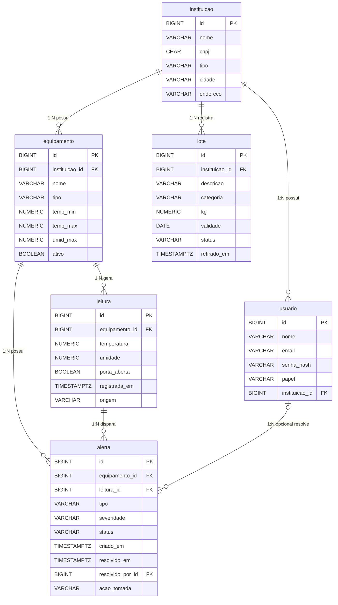

# Diagrama Entidade-Relacionamento — Frio Solidário

## Modelo de dados

O banco de dados do Frio Solidário possui seis entidades,
conforme a seção 4.7 da Proposta A da Global Solution FIAP.

O diagrama apresenta os atributos, chaves primárias (PK),
chaves estrangeiras (FK) e cardinalidades.

## Diagrama ER

## Cardinalidades

| Relacionamento | Cardinalidade | Descrição |
|---|---|---|
| Instituição → Usuário | 1:N | Uma instituição possui vários usuários |
| Instituição → Equipamento | 1:N | Uma instituição possui vários equipamentos |
| Instituição → Lote | 1:N | Uma instituição registra vários lotes |
| Equipamento → Leitura | 1:N | Um equipamento gera várias leituras |
| Equipamento → Alerta | 1:N | Um equipamento pode gerar vários alertas |
| Leitura → Alerta | 1:N | Uma leitura pode disparar vários alertas |
| Usuário → Alerta | 1:N opcional | Um usuário pode resolver vários alertas; um alerta pode ainda não ter responsável |

## Regras de integridade

- Cada tabela possui uma chave primária `id`.
- `usuario.email` deve ser único.
- `instituicao.cnpj` deve ser único.
- A temperatura mínima deve ser menor que a máxima.
- A umidade deve respeitar os limites definidos no banco.
- Cada leitura pertence a um equipamento.
- Cada alerta referencia uma leitura do mesmo equipamento.
- Um alerta resolvido possui data e usuário responsável.
- A ação tomada é opcional e só existe em alerta resolvido.
- As chaves estrangeiras garantem a integridade dos relacionamentos.

## Regras de domínio

- **Papel do usuário:** ADMIN ou VOLUNTARIO.
- **Tipo da instituição:** BANCO, MERCADO ou PADARIA.
- **Tipo do equipamento:** CAMARA, GELADEIRA ou FREEZER.
- **Origem da leitura:** SENSOR ou SIMULADO.
- **Tipo do alerta:** TEMP_ALTA, TEMP_BAIXA, PORTA_ABERTA ou UMIDADE.
- **Status do alerta:** ABERTO ou RESOLVIDO.
- **Ação tomada na resolução (opcional):** AJUSTOU, TRANSFERIU_LOTE ou DESCARTOU.
- **Status do lote:** DISPONIVEL, DISTRIBUIDO ou PERDIDO.

Coerência entre status e datas:

- Alerta ABERTO não tem data nem responsável de resolução; alerta RESOLVIDO tem os dois, e a
  resolução não pode ser anterior à criação.
- Lote DISPONIVEL não tem data de retirada; lote DISTRIBUIDO ou PERDIDO tem — sem isso, um lote
  distribuído sem data sairia da consulta de kg doados sem aviso.

Observação: os valores de severidade do alerta devem ser
validados com a equipe responsável pela API.

## Implementação

O modelo foi implementado em PostgreSQL 17.

Arquivos relacionados:

- `db/schema.sql`
- `db/seed.sql`
- `db/verificar.sql`
- `db/consultas.sql`
- `db/testar.ps1`
- `db/evidencias/teste_postgresql.log`

As classes de entidade equivalentes ficam em `src/FrioSolidario.Domain/Entities` e o mapeamento
EF Core em `src/FrioSolidario.Infrastructure/Persistence/FrioSolidarioDbContext.cs`.